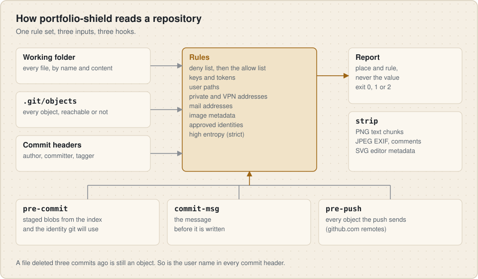

# portfolio-shield

A single-file Python tool that stops private details reaching a public git repository: it reads every object in the repository, not only the files you can see.

## At a glance

- **What it is.** A scanner and a set of git hooks. It looks for keys and tokens, local user paths, private and VPN addresses, private domains and ports, mail addresses you have not approved, AI session files, and hidden metadata in PNG, JPEG and SVG files.
- **Why it reads the object database.** A file you deleted three commits ago is still in the history, and so is your machine's user name in every commit header. A scan of the working folder sees neither.
- **My part.** I wrote the requirements after auditing my own older public repositories, chose the rules and the fail-closed behaviour, and reviewed every test.
- **Stack.** Python 3.10 or later, standard library only (tested on 3.10, 3.12 and 3.14). Git 2.30 or later.
- **Measured.** 33 tests (38 sub-cases) pass in 5 to 44 seconds on Windows 11 across Python 3.10, 3.12 and 3.14 (2026-11-25, `python -m unittest`). Most of that time is the hook tests, which create real repositories and commits.

<picture>
  <source media="(prefers-color-scheme: dark)" srcset="diagrams/how-it-reads-dark.svg">
  
</picture>

## What it checks

| Rule | Finds |
|---|---|
| `windows-user-path`, `home-path` | Windows user-folder paths and `/home/<name>` style paths |
| `private-ip`, `cgnat-ip`, `ts-ipv6`, `ts-hostname`, `custom-cidr` | LAN addresses, the 100.64/10 carrier-grade NAT range mesh VPNs use, their IPv6 prefix and machine names, and any ranges you add |
| `github-token`, `aws-key`, `api-key`, `private-key`, `jwt`, `secret-assignment` | Common key formats and `password = "..."` style lines |
| `webhook`, `tunnel` | Chat webhooks and tunnel host names |
| `email` | Any address that is not on your allow list, a no-reply address or an example domain |
| `deny-list` | Your own private words: user name, project names, domains, ports |
| `high-entropy` | Long random-looking runs (strict mode only; lock files are passed over) |
| `sensitive-file` | `.env`, key files, `.claude/`, `.mcp.json`, `*.jsonl` logs and similar, by name |
| `image-metadata` | PNG text, EXIF and time chunks, JPEG EXIF and comments, SVG editor metadata |
| `identity` | A commit author or committer who is not on your approved list |

A finding prints the place and the rule, and never the value it found:

```
blob 1a2b3c4d5e config/settings.py:12: github-token (gh.. 40 chars)
commit 5f6e7d8c9b: identity (author not approved: Al.. 27 chars)
```

## Quick start

```sh
# 1. Your private values. Keep this file out of every repository.
cp private-identifiers.example.json ~/.portfolio-shield/private-identifiers.json

# 2. Scan a folder, and its whole git history if it has one.
python portfolio_shield.py scan path/to/repo --strict

# 3. Remove metadata from pictures before you commit them.
python portfolio_shield.py strip assets/

# 4. Check every commit, and every push to github.com, from now on.
python portfolio_shield.py install-hook path/to/repo
```

Exit codes: `0` clean, `1` findings, `2` a usage or configuration problem. Strict mode refuses to run without an identifiers file and at least one approved identity, so a missing file fails closed instead of passing quietly.

## The identifiers file

```json
{
  "deny": ["my-username", "=MyLaptop", "internal.example", ":7000"],
  "denylist_files": ["~/.config/other-tool/denylist.txt"],
  "cidrs": ["198.51.100.0/24"],
  "allowed_emails": ["<your public contact address>"],
  "approved_identities": ["Your Name <your GitHub no-reply address>"]
}
```

An optional `"allow": [...]` list, or `--allow` on the command line, names exact strings that no rule may flag, such as your public GitHub handle when your deny list blocks the name it shares with a private address. Allowed strings are blanked before any rule runs, so keep them long and specific.

A plain entry matches anywhere, in any letter case. An entry that starts with `=` keeps its case and must not touch another letter, so `=Kit` finds `Kit` and `Kit_2` but not `kitchen`. Entries can come from other one-per-line files, so a deny list you already keep for another tool needs no copy.

## Hooks

`install-hook` writes three hooks into `.git/hooks`:

- `pre-commit` reads the staged blobs from the index (not the working folder) and checks the author and committer identity git is about to use.
- `commit-msg` checks the message.
- `pre-push` checks every object reachable from the commits being pushed, so a commit made with `--no-verify` is still caught. By default it only acts on `github.com` remotes; `--all-remotes` widens it.

## Limits

- It finds what its rules describe. A secret split across lines, re-encoded, or written into an image's pixels will not be found.
- `high-entropy` guesses. It will flag some harmless strings and miss short secrets.
- Once something has been pushed to a public repository, assume it has been copied. Rewriting history afterwards narrows the exposure; it does not undo it.
- Hooks are local. Anyone can skip them. They are a seatbelt, not a lock.

## How this was made

Claude Code wrote most of the code under my direction. I set the requirements, chose the rules and the fail-closed defaults, read and ran the tests, and approved the result. The tests were written before the code, and the tool has to pass its own strict scan before any release: every "bad" string in the tests is assembled at run time, so the source files scan clean.

## Licence

MIT. See [LICENSE](LICENSE).
